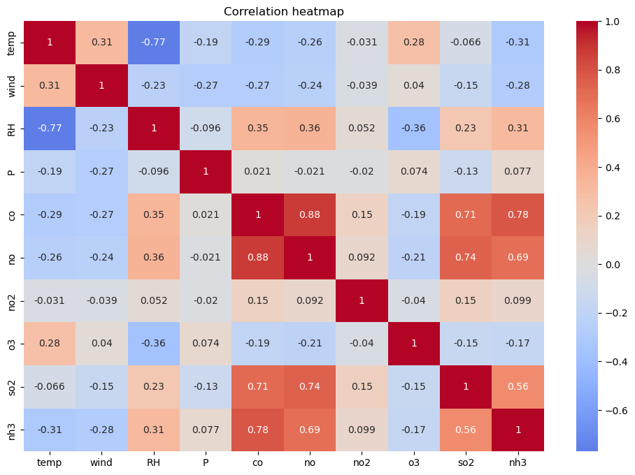
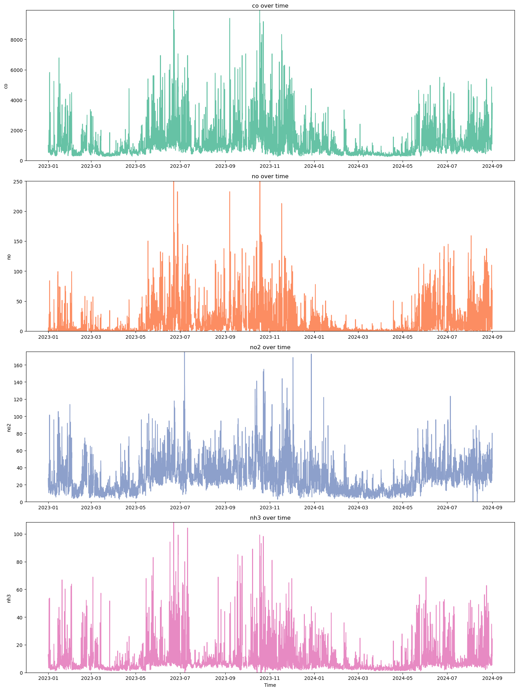
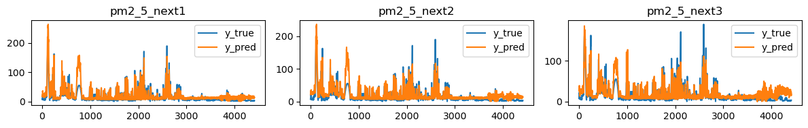

# 🌫️ Dự Báo Nồng Độ Bụi Mịn PM2.5 & PM10 tại TP. Thủ Đức Bằng Phương Pháp Học Máy Thống Kê
> **Đồ án môn học:** DS102 - Thống kê trong Khoa học Dữ liệu  
> **Trường:** Đại học Công nghệ Thông tin – ĐHQG-HCM (UIT)

[](https://www.python.org/)
[](https://scikit-learn.org/)
[](https://xgboost.readthedocs.io/)
[](https://lightgbm.readthedocs.io/)
[](https://opensource.org/licenses/MIT)

---

## 📌 1. Giới Thiệu Đề Tài

Tình trạng ô nhiễm không khí tại Việt Nam, đặc biệt là khu vực **TP. Thủ Đức (TP. Hồ Chí Minh)** đang ở mức báo động và ảnh hưởng nghiêm trọng đến sức khỏe cộng đồng. Trong đó, bụi mịn **PM2.5** và bụi thô **PM10** là hai tác nhân nguy hiểm nhất có khả năng xâm nhập sâu vào hệ hô hấp và tim mạch.

Dự án này ứng dụng các phương pháp **Học máy Thống kê (Statistical Machine Learning)** trên dữ liệu chuỗi thời gian (Time-Series) đa chiều (kết hợp các thông số khí tượng và chất ô nhiễm) để giải quyết bài toán:
> **Dự báo ngắn hạn đa bước (Multi-step ahead forecasting):** Dự đoán chính xác nồng độ **PM2.5** và **PM10** cho **1 giờ, 2 giờ và 3 giờ tiếp theo** (t+1, t+2, t+3).

---

## 👥 2. Thành Viên Nhóm Thực Hiện

| STT | Họ và Tên | MSSV | Email |
| :---: | :--- | :---: | :--- |
| 1 | **Triệu Đức Duy** | 23520392 | `23520392@gm.uit.edu.vn` |
| 2 | **Lê Tùng Dương** | 23520348 | `23520348@gm.uit.edu.vn` |
| 3 | **Đỗ Trần Thế Bảo** | 23520096 | `23520096@gm.uit.edu.vn` |
| 4 | **Nguyễn Đình Đại** | 23520216 | `23520216@gm.uit.edu.vn` |

---

## 📊 3. Thu Thập & Đặc Trưng Dữ Liệu

Dữ liệu được thu thập liên tục theo từng giờ tại tọa độ TP. Thủ Đức từ tháng **09/2021 đến tháng 08/2025** (hơn **35.000 mẫu thời gian**), tích hợp từ 2 nguồn API uy tín:
* **OpenWeatherMap API**: Dữ liệu nồng độ các chất hóa học ô nhiễm.
* **Open-Meteo API**: Dữ liệu điều kiện thời tiết và khí tượng.

### Các biến trong tập dữ liệu:
* **Khí tượng:** Nhiệt độ (`temp`), Độ ẩm (`RH`), Áp suất khí quyển (`P`), Tốc độ và hướng gió (`wind`), Điều kiện thời tiết phân loại (`weather`).
* **Chất ô nhiễm không khí:** CO, NO, NO₂, SO₂, O₃, NH₃, PM2.5, PM10.
* **Biến mục tiêu (Target labels):** PM2.5(t+1), PM2.5(t+2), PM2.5(t+3) và PM10(t+1), PM10(t+2), PM10(t+3).

<p align="center">
  
  <br/>
  <em>Hình 1: Biểu đồ nhiệt (Heatmap) thể hiện tương quan giữa các biến khí tượng và chất ô nhiễm</em>
</p>

### Phân chia tập dữ liệu:
* **Train Set (75%):** 09/2021 – 08/2024 (Huấn luyện mô hình).
* **Validation Set (12.5%):** 09/2024 – 02/2025 (Điều chỉnh siêu tham số với Optuna).
* **Test Set (12.5%):** 03/2025 – 08/2025 (Đánh giá độc lập và đối chứng baseline).

<p align="center">
  
  <br/>
  <em>Hình 2: Xu hướng chuỗi thời gian và chu kỳ biến thiên của các chỉ số ô nhiễm</em>
</p>

---

## ⚙️ 4. Quy Trình Xử Lý & Kỹ Thuật (Pipeline)

```
┌─────────────────────────────────────────────────────────────┐
│          Dữ liệu thô thu thập (09/2021 - 08/2025)            │
│         (Thời tiết Open-Meteo + Hóa học OpenWeather)        │
└──────────────────────────────┬──────────────────────────────┘
                               │
                               ▼
┌─────────────────────────────────────────────────────────────┐
│          1. Xử lý giá trị khuyết (Missing Values)           │
│   • Biến số: Cubic Spline Interpolation (giữ trend ngày)    │
│   • Biến phân loại: Rolling Majority Window (cửa sổ 2h)     │
└──────────────────────────────┬──────────────────────────────┘
                               │
                               ▼
┌─────────────────────────────────────────────────────────────┐
│          2. Lọc & Hiệu chỉnh Outlier chuỗi thời gian        │
│   • Friedman’s Super Smoother bóc tách trend & tính residual│
│   • Hampel Filter (Rolling Median) làm mượt điểm cực đoan   │
└──────────────────────────────┬──────────────────────────────┘
                               │
                               ▼
┌─────────────────────────────────────────────────────────────┐
│          3. Kỹ thuật tạo đặc trưng (Feature Engineering)    │
│   • Log Transformation: Giảm lệch (skewness > 1.5)          │
│   • Rank Encoding: Mã hóa điều kiện thời tiết               │
│   • Temporal Features: Giờ, ngày, tháng, thứ, hàm sin/cos   │
│   • Lag Features: Độ trễ lịch sử (lag 1h - 24h)             │
│   • MinMaxScaler: Chuẩn hóa toàn bộ về khoảng [0, 1]         │
└──────────────────────────────┬──────────────────────────────┘
                               │
                               ▼
┌─────────────────────────────────────────────────────────────┐
│          4. Huấn luyện & Tối ưu siêu tham số (Optuna)       │
│        (XGBoost, Random Forest, LightGBM, ElasticNet)       │
└──────────────────────────────┬──────────────────────────────┘
                               │
                               ▼
┌─────────────────────────────────────────────────────────────┐
│          5. Dự báo đa bước nồng độ PM2.5 & PM10             │
│                 (t+1 giờ, t+2 giờ, t+3 giờ)                 │
└─────────────────────────────────────────────────────────────┘
```

### Chi tiết các bước kỹ thuật:

#### 1. Xử lý giá trị khuyết (Missing Values)
* **Biến liên tục (Numeric):** Do dữ liệu thể hiện rõ tính chu kỳ ngày đêm (diurnal pattern), nhóm áp dụng **Cubic Spline Interpolation** để nội suy làm mượt, tránh đứt gãy xu hướng tự nhiên.
* **Biến phân loại (Categorical - Weather):** Sử dụng kỹ thuật **Rolling Majority Window (Cửa sổ 2 giờ)** để lấy mode lân cận. Nếu khuyết cả cửa sổ, điền bằng mode theo đúng khung giờ đó trên toàn bộ dữ liệu.

#### 2. Xử lý ngoại lai chuỗi thời gian (Outliers Handling)
* Thay thế giá trị âm bất hợp lý bằng giá trị trung bình dương của cột.
* Áp dụng **Friedman’s Super Smoother** để bóc tách trend và tính residual: `r_t = x_t - x̂_t`, phát hiện điểm bất thường dựa trên ngưỡng IQR (`Q1 - 1.5*IQR` và `Q3 + 1.5*IQR`).
* Sử dụng **Hampel Filter** (rolling median) để điều chỉnh các điểm ngoại lai cục bộ nhằm bảo toàn tính liên tục của chuỗi.

#### 3. Kỹ thuật tạo đặc trưng (Feature Engineering)
* **Log Transformation:** Giảm độ lệch phải (skewness > 1.5) của các khí ô nhiễm (CO, NO, SO₂,...).
* **Rank Encoding:** Mã hóa biến phân loại thời tiết dựa trên tương quan thứ hạng với nồng độ bụi.
* **Trích xuất đặc trưng thời gian (Temporal Features):** Năm, tháng, ngày, thứ trong tuần, giờ trong ngày, và mã hóa hàm số vòng lặp (sin/cos).
* **Đặc trưng độ trễ (Lag Features):** Trượt cửa sổ lịch sử từ 1 đến 24 giờ (lag₁ ... lag₂₄) giúp mô hình ghi nhận quán tính khí quyển.
* **MinMaxScaler:** Chuẩn hóa toàn bộ đặc trưng số về đoạn [0, 1].

---

## 🔬 5. Kết Quả Thực Nghiệm & Đánh Giá

Nhóm đã thử nghiệm và tinh chỉnh siêu tham số bằng **Optuna (Bayesian Optimization)** trên 4 họ mô hình:
1. **Linear Regression / ElasticNet** (Baseline thống kê)
2. **Random Forest Regressor**
3. **LightGBM Regressor**
4. **XGBoost Regressor**

### Kết quả trên tập Test độc lập:

| Mục tiêu dự báo | Mô hình tốt nhất | RMSE (µg/m³) | R² Score | Cải thiện so với Open-Meteo API |
| :--- | :---: | :---: | :---: | :---: |
| **PM2.5 (+1h)** | **XGBoost / Random Forest** | **~13.5 - 14.5** | **> 0.64** | Giảm sai số **3 - 8 µg/m³** |
| **PM2.5 (+2h)** | **Random Forest** | **~13.8 - 14.8** | **> 0.60** | Giảm sai số **4 - 9 µg/m³** |
| **PM2.5 (+3h)** | **XGBoost / Random Forest** | **~14.5 - 15.5** | **> 0.58** | Giảm sai số **5 - 10 µg/m³** |
| **PM10 (+1h đến +3h)** | **Random Forest** | **~25.0 - 29.5** | **> 0.55** | Tốt hơn đáng kể so với baseline |

<p align="center">
  
  <br/>
  <em>Hình 3: Kết quả dự báo của XGBoost so với nồng độ thực tế trên tập Test (t+1, t+2, t+3)</em>
</p>

> 💡 **Nhận xét:** Mô hình máy học đề xuất đạt hiệu năng vượt trội hơn so với dự báo của Open-Meteo API từ **3 đến 10 µg/m³**, chứng minh tính hiệu quả của pipeline tiền xử lý và đặc trưng hóa chuyên biệt cho điều kiện vi khí hậu tại TP. Thủ Đức.

---

## 📂 6. Cấu Trúc Thư Mục Repository

```text
pm10-pm2.5-ThuDuc-time-series-forecast-model/
│
├── assets/                                     # Hình ảnh minh họa cho README
│   ├── correlation_heatmap.png
│   ├── aqi_timeseries.png
│   └── pm25_xgb_prediction.png
│
├── Dataset/                                    # Dữ liệu mẫu ban đầu
│   └── Data_HasTarget_NotPreocess.csv
│
├── Source_Code_With_Crawled_Data/
│   ├── 1. Collecting Data/                     # Code thu thập dữ liệu từ OpenWeather & Meteo
│   │   ├── collecting.ipynb
│   │   ├── utils.py
│   │   └── *.csv (Dữ liệu thời tiết và hóa học thô)
│   │
│   ├── 2. Exploratory Data Analyst/            # Khám phá và trực quan hóa phân tích dữ liệu
│   │   └── main_EDA.ipynb
│   │
│   ├── 3. Data Preprocessing/                  # Pipeline xử lý khuyết và lọc ngoại lai
│   │   ├── main_preprocess.ipynb
│   │   └── Data_Ready_duy.csv
│   │
│   ├── 4. Machine Learning/                    # Huấn luyện mô hình và tinh chỉnh Optuna
│   │   ├── Feature Engineer/                   # Pipeline tạo đặc trưng, lag, rank encoding
│   │   │   └── main_FE.ipynb
│   │   ├── PM2.5/                              # Thử nghiệm Linear, RF, LightGBM, XGBoost cho PM2.5
│   │   ├── PM10/                               # Thử nghiệm Linear, RF, LightGBM, XGBoost cho PM10
│   │   └── baseline_METEO.ipynb                # Đối chứng với Open-Meteo API
│   │
│   └── Demo/                                   # Notebook chạy thử nghiệm luồng dự báo hoàn chỉnh
│       ├── Used_for_Demo.ipynb
│       └── Dataset_ThuDuc_9202182025.csv
│
├── FinalReport.pdf                             # Báo cáo chi tiết định dạng bài báo khoa học
├── requirements.txt                            # Danh sách các thư viện phụ thuộc
├── .gitignore
└── README.md
```

---

## 🚀 7. Hướng Dẫn Cài Đặt & Sử Dụng

### 1. Khởi tạo môi trường
```bash
# Clone repository
git clone https://github.com/duyhoclaptrinh7/pm10-pm2.5-ThuDuc-time-series-forecast-model.git
cd pm10-pm2.5-ThuDuc-time-series-forecast-model

# Tạo và kích hoạt môi trường ảo (khuyến nghị)
python -m venv venv
# Windows:
.\venv\Scripts\activate
# Linux/macOS:
source venv/bin/activate

# Cài đặt các thư viện cần thiết
pip install -r requirements.txt
```

### 2. Chạy thử nghiệm Demo
Mở và thực thi notebook Demo tại thư mục:
```bash
jupyter notebook "Source_Code_With_Crawled_Data/Demo/Used_for_Demo.ipynb"
```
Notebook này sẽ tự động:
1. Tải 5.000 dòng dữ liệu thời gian kiểm thử.
2. Áp dụng toàn bộ `preprocess_pipeline` và `featureengineer_pipeline`.
3. Thực hiện dự báo nồng độ **PM2.5** và **PM10** cho 3 mốc thời gian tiếp theo và xuất biểu đồ so sánh.

> 📦 **Lưu ý về Pretrained Weights (`.pkl`):**  
> Do các file model weights của Random Forest và XGBoost có kích thước lớn (> 100MB), các file `.pkl` được lưu trữ tách biệt. Nếu muốn sử dụng lại model weights đã huấn luyện sẵn mà không cần train lại, bạn có thể tải model từ mục Releases trên GitHub hoặc tự động train lại qua các notebook trong `4. Machine Learning`.

---

## 📚 8. Tài Liệu Tham Khảo
1. **World Health Organization (2021)**: *WHO global air quality guidelines: particulate matter (PM2.5 and PM10), ozone, nitrogen dioxide, sulfur dioxide and carbon monoxide.*
2. **Open-Meteo Documentation**: *Air Quality & Weather Forecast APIs.*
3. **Friedman, J. H. (1984)**: *A Variable Span Smoother.* Technical Report No. 5, Laboratory for Computational Statistics, Stanford University.
4. **Hampel, F. R. (1974)**: *The Influence Curve and its Role in Robust Estimation.* Journal of the American Statistical Association.
